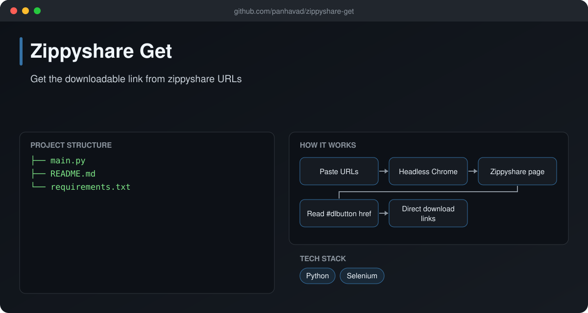

# Zippyshare Get

  [](https://github.com/panhavad/zippyshare-get/releases/latest)

A command-line tool that **turns Zippyshare share URLs into direct download links** using headless Chrome. Paste all your links, press Enter, and get a list ready for your download manager.



## Features

- Paste many URLs at once
- Headless Selenium + webdriver-manager
- Prints direct links for download managers

## How it works


## Getting started

```bash
pip install -r requirements.txt
python main.py
```

## Download

Grab the packaged source from the [latest release](https://github.com/panhavad/zippyshare-get/releases/latest).

## Tech stack

- Python
- Selenium

## Project structure

```text
zippyshare-get/
├── docs/
├── main.py
├── README.md
└── requirements.txt
```

## Original notes

Only work with zippyshare link

0. `pip install -i requirement.txt`
1. `python ./main.py`
2. paste all zippyshare URLs want to extract downable
3. give a empty input to start the extraction
4. wait for result
5. copy result and enjoy the download 💘
